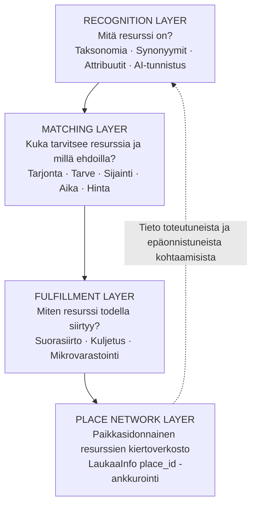
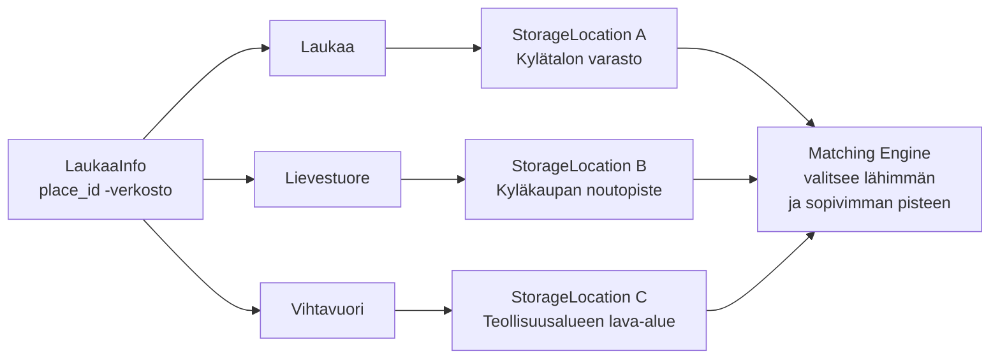
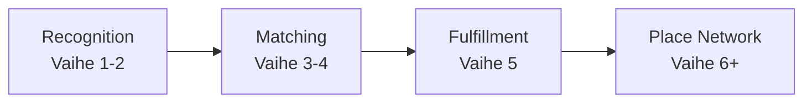

# LostReFound — Resurssien kohtaamisarkkitehtuuri
*Pitkän aikavälin arkkitehtuuriperiaate — 20.11.2026*

---

## Visio

> **LostReFound kehittyy ilmoitussovelluksesta paikalliseksi resurssien kiertoa ohjaavaksi järjestelmäksi.**

Tässä visiossa järjestelmä ei vain yhdistä yksittäisiä ilmoituksia, vaan alkaa tunnistaa alueellisia resurssivirtoja: mitä materiaaleja tietyllä alueella on tarjolla, mitä tarvitaan, ja missä fyysinen kiertoinfrastruktuuri — mikrovarastot, noutopisteet, kuljetuskapasiteetti — toisi eniten lisäarvoa.

---

## Nelikerroksinen arkkitehtuuri

---

## Kerrosten kuvaukset

### 1. Recognition Layer — Tunnistaminen ja taksonomia
*"Mitä resurssi on?"*

Järjestelmän on ymmärrettävä, mitä käyttäjät tarjoavat ja tarvitsevat, vaikka he käyttävät eri sanoja. Tämä kerros huolehtii siitä, että "kakkosnelonen", "48×98" ja "rakennuslankku" tunnistetaan saman resurssin eri ilmaisutavoiksi.

**Vastuut:**
- Kolmitasoinen taksonomia (category → concept → attributes)
- Synonyymi- ja aliasrekisteri (`taxonomy_aliases`)
- AI-avusteinen tunnistaminen vapaamuotoisesta tekstistä
- Oppiva taksonomia: käyttäjäilmaisut → ehdotukset → ihmisen hyväksymä päivitys

**Valmis kun:** Sama resurssi löytyy eri käyttäjien ilmaisutavoilla. Taksonomia kasvaa hallitusti ilman käsitehajautumaa.

---

### 2. Matching Layer — Kohtaaminen
*"Kuka tarvitsee resurssia ja millä ehdoilla kohtaaminen onnistuu?"*

Tämä kerros vertaa resursseja toisiinsa ja arvioi kohtaamisen todennäköisyyden. Keskeinen erottelu:

- **match_confidence** — Kuinka hyvin resurssit vastaavat toisiaan (tuoteosuma).
- **fulfillment_score** — Kuinka helposti resurssi saadaan tosiasiallisesti siirrettyä.

**Vastuut:**
- Kaksivaiheinen pisteytys (yhteensopivuuden gate → kohtaamisen optimointi)
- Osittaisten matchien hallinta ("20 kpl tarjolla, haetaan 50 kpl")
- `matches`-taulu: jokainen ehdotus, hyväksyntä ja hylkäys tallentuu analysoitavaksi
- Eriytetyt kynnysarvot eri resurssityypeille

**Valmis kun:** Järjestelmä ehdottaa käyttäjille hyviä kohtaamisia ilman, että käyttäjä osaa itse etsiä oikealla sanalla.

---

### 3. Fulfillment Layer — Toimituksen toteutus
*"Miten resurssi todella siirtyy tarjoajalta tarvitsijalle?"*

| Polku | Milloin sopii | Mekanismi |
|---|---|---|
| **Suorasiirto** | Aikataulut ja etäisyys täsmäävät heti | Suora sopimus, noutokoodi |
| **Kuljetus** | Etäisyys liian suuri, kapasiteetti löytyy | Kuljetusresurssin matching |
| **Mikrovarastointi** | Aikaikkuna tai etäisyys ei täsmää suoraan | `StorageLocation` + QR + PIN, ennakoiva tai varapolku |

> **Tärkeä periaate:** Mikrovarasto ei ole vain epäonnistuneen suoran matchin varasuunnitelma. Tarjoaja voi jo ilmoitusvaiheessa valita mikrovarastoinnin, jolloin sopivaa hakijaa ja varastopaikkaa etsitään samanaikaisesti.

**Valmis kun:** Toteutunut kohtaaminen on kuitattu (QR/PIN), varasto vapautuu, ja tilakoneen läpikulku on jäljitettävissä.

---

### 4. Place Network Layer — Alueellinen resurssikiertoverkosto
*"Paikkasidonnainen resurssien kiertoverkosto"*

`place_id` ei ole vain ilmoituksen sijainti — se on resurssien, varastojen, tarvitsijoiden ja kohtaamisten **yhteinen alueellinen ankkuri**.

**Mitä place_id mahdollistaa:**
- Alueellinen resurssitilannekuva: mitä on tarjolla, mitä haetaan, missä on varastokapasiteettia.
- Mikrovarastojen sijoituslogiikka: mihin rakentaa seuraava noutopiste kysyntädatan perusteella.
- Resurssiketjujen tunnistaminen: tavara + kuljetus + välitila + tarvitsija löytyvät saman alueen kautta.
- Jaettu paikkainfrastruktuuri LaukaaInfon kanssa ilman rinnakkaista hierarkiaa.

**Valmis kun:** Järjestelmä osaa ehdottaa konkreettista varastopaikkaa, joka sijaitsee tarjoajan ja hakijan arjen kulkureittien varrella.

---

## Kerrosten kehitysjärjestys

> Ensin **tunnistaminen** luotettavaksi, sitten **kohtaaminen**, sen jälkeen **toimituksen logistiikka**. Analytiikka seuraa perässä — ei ennen.

---

## Tiedon kertyminen kehittämisen tueksi

Jokainen toteutunut tai epäonnistunut kohtaaminen tuottaa tietoa järjestelmän kehittämiseen:

| Tieto | Lähde | Hyöty |
|---|---|---|
| Hylätyt match-ehdotukset | `matches.match_status = REJECTED` | Mitä pisteytyslogiikka arvioi väärin? |
| Tunnistamaton sanasto | `taxonomy_suggestions` | Mitä puuttuu taksonomiasta? |
| Vanhentuneet mikrovarastovaraukset | `match_status = EXPIRED` | Missä noutoikkuna on liian lyhyt? |
| Suosituimmat alueelliset kategoriat | `item_concepts` + `place_id` | Mihin mikrovarasto kannattaa seuraavaksi rakentaa? |

> **Periaate:** Analytiikkaa ei rakenneta ensin. Mutta tietomalli suunnitellaan niin, että analytiikka on mahdollista rakentaa myöhemmin ilman migraatioita.

---

## Suhde muihin dokumentteihin

| Dokumentti | Fokus |
|---|---|
| `LOSTNFOUND_KIERTOTALOUS_JA_MIKROVARASTOINTI.md` | Alkuperäinen kiertotalousidea, tilakone, perustietomallit |
| `LOSTNFOUND_TAKSONOMIA_JA_MATCHING_ARKKITEHTUURI.md` | Taksonomian rakenne, Supabase-skeema, kaksivaiheinen pisteytys |
| **Tämä dokumentti** | Nelikerroksinen arkkitehtuuriperiaate, pitkän aikavälin visio |

---

*Arkkitehtuuriperiaate — 20.11.2026*

