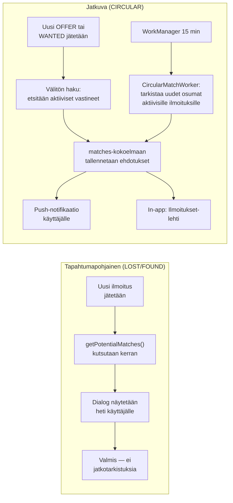

# Jatkuvan matchauksen tekninen toteutusmalli
*LostReFound — CIRCULAR-kategoria vs. tapahtumapohjainen LOST/FOUND — 20.11.2026*

---

## Tärkein ennakkolöydös: WorkManager on jo olemassa

Ennen spesifikaatiota on huomioitava merkittävä havainto koodista:

**`FollowedAreaWorker` + `WorkManager` on jo rakennettu ja toimii** (`LandingScreen.kt` r. 500–508, `FollowedAreaWorker.kt`):

```kotlin
// Ajaa joka 15 minuutti, vaatii verkkoyhteyden
val workRequest = PeriodicWorkRequestBuilder<FollowedAreaWorker>(15, TimeUnit.MINUTES)
    .setConstraints(Constraints.Builder().setRequiredNetworkType(NetworkType.CONNECTED).build())
    .build()
WorkManager.getInstance(context).enqueueUniquePeriodicWork(
    "FollowedAreaWorker", ExistingPeriodicWorkPolicy.UPDATE, workRequest
)
```

Nykyinen worker hakee alueelle uudet ilmoitukset ja lähettää push-notifikaation. Se on jo **täsmälleen sama infrastruktuuri**, jonka päälle CIRCULAR-matching rakennetaan — ei tarvita uutta taustatekniikkaa.

---

## 1. Kaksi erilaista matchausmallia — tekninen erottelu



**LOST/FOUND ei muutu.** Kaikki muutokset ovat additiivisia.

---

## 2. Mitä minimimuutoksia tarvitaan ennen ensimmäistäkään koodimuutosta

### 2.1 Välttämättömät tietomallimuutokset (ilmoitusten tallentamiseen)

```kotlin
// ItemCategory.kt — ainoa muutos enum:iin
enum class ItemCategory {
    LOST, FOUND, DELIVERED,
    CIRCULAR_OFFER,   // ← UUSI: "Tarjotaan kiertoon"
    CIRCULAR_WANTED   // ← UUSI: "Etsitään kierrätystavaraa"
}
```

```kotlin
// LostItem.kt — kolme nullable-kenttää
val deadlineAt: Timestamp? = null       // Eroonpäästävä viimeistään (CIRCULAR_OFFER)
val condition: String? = null           // "NEW" | "GOOD" | "FAIR" | "FOR_PARTS"
val preferredPickup: String? = null     // "DIRECT_ONLY" | "STORAGE_OK" | "EITHER"
// HUOM: tags-kenttää EI lisätä vielä — ks. perustelu kohdassa 2.3
```

```kotlin
// StorageLocation.kt — yksi kenttä
val placeId: String? = null             // LaukaaInfo place_id -kytkentä
```

Nämä kolme muutosta ovat **ehdottomia minimivaatimuksia** CIRCULAR-ilmoitusten tallentamiseen. Kaikki nullable — olemassa olevat Firestore-dokumentit deserialisoituvat edelleen oikein.

### 2.2 Matchauksen toteuttamiseen tarvittavat rakenteet

Nämä eivät mene Kotlin-tietomalleihin, vaan **Firestoreen uutena kokoelmana**:

```
Firestore-kokoelma: "circular_matches"
Dokumentti: {
    id: String                    // autoId
    offerId: String               // CIRCULAR_OFFER -ilmoituksen id
    wantedId: String              // CIRCULAR_WANTED -ilmoituksen id
    geoScore: Float               // 0.0–1.0 etäisyyspisteytys
    timeScore: Float              // 0.0–1.0 aikayhteensopivuus
    matchScore: Float             // kokonaispistemäärä (vaihe 1: vain geo+time)
    status: String                // "PROPOSED" | "ACCEPTED" | "REJECTED" | "EXPIRED"
    createdAt: Timestamp
    seenByOffer: Boolean          // onko tarjoaja nähnyt ehdotuksen
    seenByWanted: Boolean         // onko hakija nähnyt ehdotuksen
    storageLocationId: String?    // jos mikrovarastoehdotus mukana
}
```

**Miksi Firestore eikä Supabase tässä vaiheessa?**
- CIRCULAR-ilmoitukset tallennetaan Firestoreen (sama `lostItems`-kokoelma).
- `listenToItems()` -kuuntelija on jo Firestoressä.
- Siirtyminen Supabaseen on erillinen päätös myöhemmin.
- `circular_matches` -kokoelma on helppo migroida Supabaseen myöhemmin ilman sovelluksen uudelleenkirjoitusta.

### 2.3 Miksi tags-kenttää ei lisätä vielä

Tagit ilman taksonomiaa ovat vapaamuotoisia merkkijonoja, jotka eivät auta matchauksessa. Ennen tageja tarvitaan päätös siitä, tallennetaanko ne vapaina teksteinä vai concept_id-viittauksina. Tämä on taksonomia-kysymys, ei tietomalli-kysymys. **Tagit tulevat vaiheessa 4.**

---

## 3. Jatkuvan matchauksen käynnistysmekanismi

Nykyinen `FollowedAreaWorker` laajennetaan tai sen rinnalle rakennetaan `CircularMatchWorker`:

```kotlin
class CircularMatchWorker(
    private val context: Context,
    workerParams: WorkerParameters
) : CoroutineWorker(context, workerParams) {

    override suspend fun doWork(): Result = withContext(Dispatchers.IO) {
        val firebaseService = FirebaseService()
        val activeOffers  = firebaseService.getActiveCircularItems(ItemCategory.CIRCULAR_OFFER)
        val activeWanteds = firebaseService.getActiveCircularItems(ItemCategory.CIRCULAR_WANTED)

        for (offer in activeOffers) {
            for (wanted in activeWanteds) {
                // Tarkista: onko tämä pari jo matches-kokoelmassa?
                val alreadyMatched = firebaseService.circularMatchExists(offer.id, wanted.id)
                if (alreadyMatched) continue

                val score = computeCircularMatchScore(offer, wanted)
                if (score.total >= MATCH_THRESHOLD) {
                    firebaseService.saveCircularMatch(offer, wanted, score)
                    // notifikaatio molemmille käyttäjille (olemassa oleva notif-infrastruktuuri)
                }
            }
        }
        Result.success()
    }
}
```

**Enqueuing** (sama pattern kuin `FollowedAreaWorker`):

```kotlin
// Käynnistetään kun käyttäjä jättää CIRCULAR-ilmoituksen
// + rekisteröidään pysyvänä periodic-workina
WorkManager.getInstance(context).enqueueUniquePeriodicWork(
    "CircularMatchWorker",
    ExistingPeriodicWorkPolicy.KEEP,  // ei uudelleenkäynnistystä jos jo ajossa
    PeriodicWorkRequestBuilder<CircularMatchWorker>(15, TimeUnit.MINUTES)
        .setConstraints(Constraints.Builder().setRequiredNetworkType(NetworkType.CONNECTED).build())
        .build()
)
```

---

## 4. Päällekkäisyyksien esto: match-pari tallennetaan vain kerran

Ilman esto-logiikkaa sama pari (offerA, wantedB) voisi tuottaa kymmeniä ehdotuksia 15 min välein.

**Esto-strategia: `circularMatchExists()`**

```kotlin
// FirebaseService.kt
suspend fun circularMatchExists(offerId: String, wantedId: String): Boolean {
    return try {
        val existing = db.collection("circular_matches")
            .whereEqualTo("offerId", offerId)
            .whereEqualTo("wantedId", wantedId)
            .whereIn("status", listOf("PROPOSED", "ACCEPTED"))
            .get()
            .await()
        existing.documents.isNotEmpty()
    } catch (e: Exception) { false }
}
```

**Seuraus:** Sama pari voi saada uuden ehdotuksen vain jos:
- Aiempi ehdotus on `REJECTED` tai `EXPIRED`
- Jompikumpi ilmoitus on muuttunut merkittävästi (esim. `deadlineAt` siirtynyt)

---

## 5. Matchauksen käynnistymistapahtumat

| Tapahtuma | Mekanismi | Toteutuspaikka |
|---|---|---|
| **Uusi CIRCULAR_OFFER jätetään** | Välitön haku aktiivisista CIRCULAR_WANTED -ilmoituksista | `AddLostItemScreen.kt`, heti `addItem()` jälkeen |
| **Uusi CIRCULAR_WANTED jätetään** | Välitön haku aktiivisista CIRCULAR_OFFER -ilmoituksista | Sama |
| **Ilmoituksen muutos** (deadline, sijainti) | Poistaa aiemmat PROPOSED-matchit → uusi haku | `EditItemScreen.kt` tai `updateItem()` jälkeen |
| **Taustatarkistus 15 min välein** | `CircularMatchWorker` tarkistaa kaikki aktiiviset parit | WorkManager (nykyinen infrastruktuuri) |
| **Ilmoituksen vanheneminen** (`expiresAt` tai `deadlineAt`) | Sulkee ko. ilmoitukseen liittyvät PROPOSED-matchit | Worker tai Firestore Cloud Function (myöhemmin) |

**Ilmoituksen vanheneminen — kriittinen kohta:**
Tässä on potentiaalinen haaste Android-ympäristössä: jos käyttäjän puhelin on offline, `expiresAt`-sulkeminen ei tapahdu. Tämä hyväksytään vaiheessa 1 — `expiresAt`-suodatus tehdään aina query-tasolla kuten nyt, jolloin vanhentuneet ilmoitukset eivät tule matchaukseen mukaan vaikka niiden statusta ei olisi päivitetty.

---

## 6. Pisteytysfunktio — versio 1 (ilman tageja)

Vaihe 1:ssä pisteytys perustuu vain sijaintiin ja aikayhteensopivuuteen — taksonomiatietoja ei vielä ole.

```kotlin
data class CircularMatchScore(
    val geo: Float,     // 0.0–1.0
    val time: Float,    // 0.0–1.0
    val total: Float    // painotettu summa
)

fun computeCircularMatchScore(offer: LostItem, wanted: LostItem): CircularMatchScore {
    // 1. Etäisyyspisteytys (Haversine — sama kuin getPotentialMatches())
    val distanceM = haversineDistance(offer.latitude, offer.longitude, wanted.latitude, wanted.longitude)
    val maxRadiusM = maxOf(offer.radius.takeIf { it > 0 } ?: 5000.0, wanted.radius.takeIf { it > 0 } ?: 5000.0)
    val geo = if (distanceM > maxRadiusM) 0f else (1f - (distanceM / maxRadiusM)).toFloat()

    // 2. Aikayhteensopivuus
    // offer.deadlineAt: milloin tarjoajan on päästävä eroon tavarasta
    // wanted.expiresAt: kuinka kauan hakija on kiinnostunut
    val now = System.currentTimeMillis()
    val offerDeadline = offer.deadlineAt?.toDate()?.time ?: (now + 14 * 24 * 3600 * 1000L)
    val wantedExpiry = wanted.expiresAt?.toDate()?.time ?: (now + 14 * 24 * 3600 * 1000L)
    val overlapMs = minOf(offerDeadline, wantedExpiry) - now
    val time = if (overlapMs <= 0) 0f else minOf(1f, (overlapMs / (7 * 24 * 3600 * 1000f)))

    return CircularMatchScore(
        geo = geo,
        time = time,
        total = 0.65f * geo + 0.35f * time  // Vaihe 1: vain geo + aika
    )
}

private const val MATCH_THRESHOLD = 0.5f   // Alhainen kynnys vaiheessa 1
```

**Vaiheessa 4** (taksonomian jälkeen) lisätään tagi-/käsite-overlap painotukseksi 35 % ja geo/time pienenee vastaavasti.

---

## 7. Miten LOST/FOUND-toiminta jää täysin ennalleen

```kotlin
// Nykyinen kutsu AddLostItemScreen:issa — EI MUUTU
val matches = firebaseService.getPotentialMatches(
    newCategory = newItem.category,  // LOST tai FOUND
    ...
)

// Uusi rinnakkainen haara (lisätään IF-haara olemassa olevan koodin jälkeen)
if (newItem.category == ItemCategory.CIRCULAR_OFFER ||
    newItem.category == ItemCategory.CIRCULAR_WANTED) {
    // → Erillinen CIRCULAR-matching-putki
    // → getPotentialMatches() ei kutsuta
}
```

Muutos on puhtaasti additiivinen `when`- tai `if`-haara — olemassa oleva LOST/FOUND-koodi ei liiku paikaltaan.

---

## 8. Toteutusjärjestys — tarkka vaiheistus ilman riskejä

### Vaihe 0 — Tietomallit (additiiviset, nolla rikkoutumisriskiä)
1. `ItemCategory.kt`: lisätään `CIRCULAR_OFFER`, `CIRCULAR_WANTED`
2. `LostItem.kt`: `deadlineAt`, `condition`, `preferredPickup` (nullable)
3. `StorageLocation.kt`: `placeId` (nullable)
4. Firestore: `circular_matches`-kokoelma luodaan (tyhjä, ei indeksejä vielä)

### Vaihe 1 — Ilmoituslomake
5. `AddLostItemScreen.kt`: ehdolliset kentät kun `CIRCULAR_OFFER`/`CIRCULAR_WANTED` valittu
6. `getItems()`-query: `whereIn`-ehto päivitetään sisältämään CIRCULAR-kategoriat

### Vaihe 2 — Välitön matching
7. `FirebaseService.kt`: `getActiveCircularItems()`, `circularMatchExists()`, `saveCircularMatch()`
8. `AddLostItemScreen.kt`: uusi CIRCULAR-haara heti `addItem()` jälkeen
9. `computeCircularMatchScore()` → `FirebaseService.kt` (tai erillinen `CircularMatcher.kt`)

### Vaihe 3 — Taustamatchaus
10. `CircularMatchWorker.kt`: uusi Worker (malli: `FollowedAreaWorker.kt`)
11. WorkManager-enqueue CIRCULAR-ilmoituksen jättämisen yhteydessä
12. Notifikaatio-infrastruktuuri: olemassa oleva `showNotification()` käyttöön

### Vaihe 4 — Mikrovaraston kytkentä
13. `StorageLocation.placeId` käyttöön `StorageLocationScreen.kt`:ssa
14. `getStorageLocationsNearby(lat, lon, radiusKm)` — uusi metodi
15. CIRCULAR-match-ehdotus sisältää varastopaikan jos suoranouto ei sovi

### Vaihe 5 — Taksonomia ja tagi-overlap
16. `LostItem.tags: List<String>` lisätään (vasta kun on taksonomia-päätös)
17. `computeCircularMatchScore()` laajenee tagi-overlappiin

---

## 9. Avoimet kysymykset ennen toteutusta

| Kysymys | Vaikutus | Päätös tarvitaan ennen vaihetta |
|---|---|---|
| Tallennetaanko CIRCULAR-ilmoitukset samaan `lostItems`-kokoelmaan vai erilliseen? | Kyselyiden rakenne, indeksit | Vaihe 1 |
| Hyväksytäänkö CIRCULAR-ilmoitukset automaattisesti vai admin-hyväksynnällä? | Moderation-työnkulku | Vaihe 1 |
| Miten käyttäjä näkee omat matchinsa? (uusi näkymä vai listanäkymässä?) | UI-rakenne | Vaihe 2–3 |
| Mihin `MATCH_THRESHOLD` asetetaan pilotissa? | Match-ehdotusten määrä | Vaihe 2 |
| Rakennetaanko `CircularMatchWorker` FollowedAreaWorker:in rinnalle vai yhdistetäänkö? | Koodikompleksisuus | Vaihe 3 |

---

*Tekninen toteutusmalli — 20.11.2026*  
*Pohjautuu koodikatselmukseen: `FirebaseService.kt`, `AddLostItemScreen.kt`, `FollowedAreaWorker.kt`, `LandingScreen.kt`*

