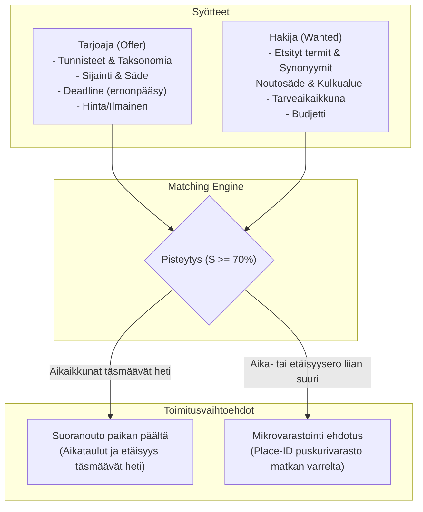
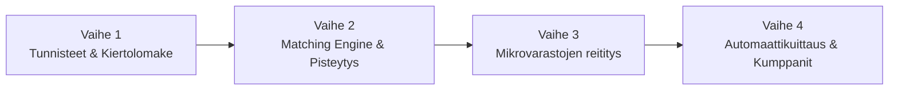

# Kiertotalous ja älykäs mikrovarastointi Lostnfound-alustalla
*Kehitysidea ja tekninen arkkitehtuurisuunnitelma*

---

## 1. Johdanto ja visio

Lostnfound-sovelluksen perusydin on kadonneiden ja löydettyjen esineiden rekisteröinti, tunnistaminen ja palauttaminen omistajilleen. Sovelluksen olemassa oleva koodipohja sisältää jo valmiiksi:
- Paikkatietokytkennät (`place_id`, koordinaatit, säde, kunnat/alueet).
- Varastopaikkahallinnan (`StorageLocation`, QR-koodit `LFRLOC-...`, tilat).
- Kiertotalouskategoriat (`circular_pallets`, `circular_reuse`, `circular_recycling`).
- Nouto- ja turvakysymyslogiikan (`securityQuestion`, lunastustiedot).

Tämä kehityssuunnitelma laajentaa järjestelmää **aktiiviseksi kohtaamis- ja kiertotalousalustaksi**, jossa kohtaavat esineiden/materiaalien tarjoajat ja tarvitsijat asynkronisesti ja paikkasidonnaisesti.

---

## 2. Ydinongelma: Aika- ja etäisyysloukku

Perinteisissä kierrätys- ja roskalavaryhmissä (esim. Facebook-ryhmät, Tori) suurin pullonkaula on **samanaikaisuuden vaatimus**:
1. **Tarjoajalla on kiire:** Tavara vie tilaa autotallissa, työmaalla tai kodissa, ja siitä halutaan eroon tiettyyn päivään mennessä (esim. ennen remonttia, viikonloppua tai muuttoa).
2. **Hakija asuu kaukana tai ei pääse heti:** Sopiva tarvitsija löytyy, mutta pääsee liikkumaan vasta 3–5 päivän kuluttua tai asuu 20 km päässä.
3. **Lopputulos:** Tavara päätyy usein kaatopaikalle tai sekajätteeseen, koska aikataulut eivät kohtaa.

### Ratkaisu: Mikrovarastot asynkronisina puskureina
Kun järjestelmään kytketään `place_id`-pohjaiset mikrovarastot (esim. taloyhtiöiden tilat, kylätalot, kierrätyspisteet, huoltoasemat, yritysten noutopisteet):
- **Toimitusajan pidentäjä:** Tarjoaja voi viedä esineen mikrovarastoon ennen omaa aikarajaansa. Hakijalla on tämän jälkeen esim. 3–7 vuorokautta aikaa noutaa se.
- **Matkan puolittaja:** Jos tarjoaja asuu Lievestuoreella ja hakija Jyväskylässä, järjestelmä voi ehdottaa kummankin arjen kulkureitille sijoittuvaa mikrovarastoa (esim. Vihtavuori tai Laukaan kirkonkylä).

---

## 3. Kohtaamislogiikka ja pisteytysalgoritmi (Matching Engine)

Kun käyttäjä tekee **"Tarjotaan kiertoon"** -ilmoituksen (vastaa nykyistä *Löydetty*) tai **"Etsitään kierrätystavaraa"** -ilmoituksen (vastaa nykyistä *Kadonnut*), algoritmi laskee match-pisteet ($S \in [0, 100]$):

$$S = w_{\text{tax}} \cdot S_{\text{tax}} + w_{\text{geo}} \cdot S_{\text{geo}} + w_{\text{time}} \cdot S_{\text{time}} + w_{\text{price}} \cdot S_{\text{price}}$$

Painotusesimerkki: $w_{\text{tax}} = 0.35$, $w_{\text{geo}} = 0.35$, $w_{\text{time}} = 0.20$, $w_{\text{price}} = 0.10$.



### 3.1. Taksonomia ja tunnisterikastus ($S_{\text{tax}}$)
- **Hierarkiat ja synonyymisanasto:**
  - Esimerkki: `rakennustarvike` $\rightarrow$ `puutavara` $\rightarrow$ `kakkosnelonen`, `lankku`, `rimat`.
  - Esimerkki: `kuormalava` $\leftrightarrow$ `eur-lava`, `teholava`, `lavakaulus`.
- **Kuntoluokitus (Condition):** `Uusi`, `Hyvä`, `Tyydyttävä`, `Varaosiksi / kunnostettavaksi`.
- Pisteytys huomioi lemmisoinnin, synonyymit ja suorat tag-osumat.

### 3.2. Geometria ja alueellisuus ($S_{\text{geo}}$)
- Laskenta perustuu `place_id`-alueisiin (kunnat, kaupunginosat, kylät) ja Haversine-etäisyyteen:
  - $d \le R_{\text{wanted}}$ ja $d \le R_{\text{offer}} \implies S_{\text{geo}} = 1.0 - (d / R_{\text{max}})$.
- Kulkureittien huomiointi: jos hakija ilmoittaa kulkevansa säännöllisesti väliä Laukaa–Jyväskylä, reitin varrella olevat pisteet saavat korkeamman pisteytyksen.

### 3.3. Aikaikkunan sovittaminen ($S_{\text{time}}$)
- Tarjoajan deadline $T_{\text{offer\_deadline}}$ (esim. "pois pe 22.11. klo 18 mennessä").
- Hakijan noutovalmius $T_{\text{need}}$ (esim. "pääsen hakemaan la 23.11.").
- **Suora nouto ei onnistu**, koska $T_{\text{need}} > T_{\text{offer\_deadline}}$.
- **Mikrovarasto kytkeytyy tähän:** Tarjoaja voi toimittaa esineen mikrovarastoon to 21.11., jolloin esineen varastoaika säilyy aktiivisena la 23.11. asti $\implies$ $S_{\text{time}}$ nousee kelvolliseksi.

### 3.4. Hintahaarukka ($S_{\text{price}}$)
- Vaihtoehdot: `Ilmainen / Annetaan`, `Nimellinen maksu`, `Pantti`, `Vaihto`.
- Jos tarjoajan hinta $\le$ hakijan maksimibudjetti $\implies S_{\text{price}} = 1.0$.

---

## 4. Mikrovarastojen tekninen toteutus (`place_id` & `StorageLocation`)

Lostnfoundissa on jo valmis `StorageLocation`-rakenne, jota voidaan hyödyntää suoraan:

```
[Tarjoaja] 
    │  1. Vie mikrovarastoon ennen deadlinea
    ▼
[Mikrovarasto (StorageLocation + place_id)]
    │  - QR-koodi: LFRLOC-VIESTIKALLIO-LOKERO-03
    │  - Tila: OCCUPIED_PENDING_PICKUP
    │  - Noutokoodi / PIN / Turvakysymys aktivoitu
    ▼
[Hakija]
    │  2. Saapuu sopivana aikana aikarajan puitteissa
    │  3. Skannaa QR-koodin / kuittaa noudon
    ▼
[Tila: COLLECTED / COMPLETED]
```

### Turvallisuus ja noudon varmennus
- **Turvakysymys tai PIN-koodi:** Järjestelmä luo matchauksen syntyessä kertakäyttöisen noutokoodin (esim. 4-numeroinen PIN tai nouto-QR-koodi).
- **Kuittaus:** Hakija skannaa mikrovaraston `LFRLOC-...` QR-koodin ja syöttää koodin, jolloin ilmoitus merkitään automaattisesti noudetuksi ja varastolokero vapautuu seuraavalle esineelle.

---

## 5. Tietomallin laajennussuunnitelma

Olemassa olevia tietomalleja täydennetään seuraavilla kentillä rikkomatta nykyistä taaksepäinyhteensopivuutta:

### 5.1. `LostItem.kt` / `items`-taulu
| Kenttä | Tyyppi | Kuvaus |
|---|---|---|
| `listingType` | `String` | `LOST`, `FOUND`, `CIRCULAR_OFFER`, `CIRCULAR_WANTED` |
| `condition` | `String?` | `NEW`, `GOOD`, `FAIR`, `FOR_PARTS` |
| `priceEur` | `Double?` | Hinta (0.0 = annetaan ilmaiseksi) |
| `deadlineAt` | `String?` | Aika, johon mennessä tavarasta on päästävä eroon |
| `tags` | `List<String>` | Rikastetut taksonomiatunnisteet (`["eur-lava", "puu"]`) |
| `preferredPickup`| `String` | `DIRECT_ONLY`, `STORAGE_OK`, `EITHER` |
| `matchedItemId` | `String?` | Ristiviittaus vastinparin ilmoitukseen |
| `pickupPin` | `String?` | Satunnainen 4- tai 6-numeroinen noutovarmenne |

### 5.2. `StorageLocation.kt` / `storage_locations`-taulu
| Kenttä | Tyyppi | Kuvaus |
|---|---|---|
| `placeId` | `String?` | Kytkentä `places`-tauluun (alueellinen ryhmittely) |
| `storageType` | `String` | `INTERNAL_OFFICE`, `COMMUNITY_HUB`, `LOCKER`, `RECYCLING_POINT` |
| `maxItemDimensions` | `String?` | Kokorajoite (`SMALL_PARCEL`, `MEDIUM`, `PALLET_OK`) |
| `isPublicDropoff` | `Boolean` | Voiko kuka tahansa jättää / vain valtuutetut |
| `operatingHours` | `String?` | Aukioloajat (esim. `24/7`, `ma-pe 8-18`) |

---

## 6. Tilakone (State Machine)

Kiertotalousvirran tilasiirtymät:

1. `OFFERED` / `WANTED`: Ilmoitus aktiivisena ilman matchia.
2. `MATCHED`: Algoritmi löytänyt osapuolille vastinparin ($S \ge 70\%$). Osapuolille lähetetään ilmoitus ja hyväksyntäpyyntö.
3. `RESERVED`: Molemmat hyväksyneet matchin. Valitaan toimitustapa: suora tai mikrovarasto.
4. `IN_STORAGE`: Tarjoaja toimittanut tavaran mikrovarastoon. Hakijalle ilmoitetaan noutoikkuna ja noutokoodi.
5. `COLLECTED`: Hakija kuitannut noudon (QR/PIN).
6. `EXPIRED`: Noutoaika umpeutunut mikrovarastossa $\rightarrow$ hälytys ylläpidolle / varajärjestely.

---

## 7. Toteutusvaiheet (Roadmap)



### Vaihe 1: Tunniste- ja taksonomiarikastus
- Lisätään `CIRCULAR_OFFER` ja `CIRCULAR_WANTED` lomakkeisiin ja tietomalliin.
- Tunnistevalitsin (tagit) ja vakiotaksonomian liittäminen ilmoituksen luontiin.
- Aikaraja- ja hintakenttien aktivointi.

### Vaihe 2: Matching Engine & Pisteytysalgoritmi
- Supabase Edge Function tai Kotlin-taustalogiikka, joka vertaa uutta ilmoitusta olemassa oleviin.
- Etäisyys- ja taksonomialaskenta ($S$-score).
- Ehdotusten näyttäminen käyttäjälle: *"3 henkilöä etsii tätä 5 km säteellä!"*

### Vaihe 3: Mikrovarastosuositus ja välietappilogiikka
- Jos suoranouto ei sovi aikataulullisesti, sovellus hakee yhteensopivat `StorageLocation`-pisteet (`place_id`).
- Ehdottaa tarjoajalle ja hakijalle sopivinta mikrovarastoa matkan varrelta.

### Vaihe 4: Noutovarmennus ja pilotointi
- PIN- ja QR-koodikuittaus mikrovaraston fyysisellä pisteellä.
- Pilotti valitussa kohteessa (esim. Laukaan kylätalot, kunnan toimipisteet tai taloyhtiöiden tilat).

---

*Dokumentti luotu kehitysideoiden seurantaa varten 19.11.2026.*

