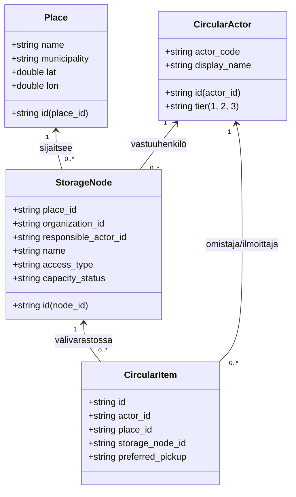
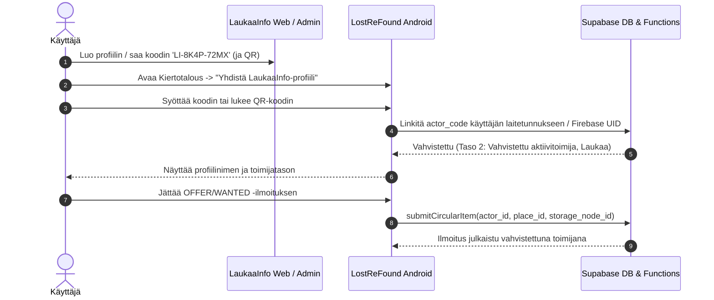

# LaukaaInfo-profilointi & Kiertotalousverkoston Arkkitehtuuri

## 1. Yhteenveto ja Periaatteet

Tämä arkkitehtuuri yhdistää **LaukaaInfo-profiloinnin**, **LostReFound-kiertotalouden** ja **fyysisen paikkaverkoston (mikrovarastot)** saumattomaksi kokonaisuudeksi:

```
┌────────────────────────────────────────────────────────┐
│              LAUKAAINFO PROFILOINTI                    │
│   • Henkilö- ja organisaatioprofiilit                  │
│   • Pysyvät profiilitunnisteet (esim. LI-8K4P-72MX)     │
│   • Vahvistukset (taso 1, 2, 3) & QR-kortit           │
└───────────────────────────┬────────────────────────────┘
                            │ Tunniste & Toimijataso
                            ▼
┌────────────────────────────────────────────────────────┐
│             LOSTREFOUND KIERTOTALOUS                   │
│   • circular_actors (palvelukohtainen toimijaliitos)  │
│   • circular_items (OFFER & WANTED -resurssit)         │
│   • Matchausmoottori (scoring.ts & jonot)              │
│   • Identiteettiä suojaava viestinvälitys              │
└───────────────────────────┬────────────────────────────┘
                            │ Nouto- & välivarastointisolmut
                            ▼
┌────────────────────────────────────────────────────────┐
│             LAUKAAINFON PAIKKAVERKOSTO                 │
│   • places (toimipisteet, rakennukset, place_id)       │
│   • circular_storage_nodes (mikrovarastot & pisteet)   │
│   • Vastuuhenkilö (actor_id) & organisaatio (org_id)   │
└────────────────────────────────────────────────────────┘
```

> [!IMPORTANT]
> **Tärkeä periaate:**
> 1. **Ei kosketa kadonneita eikä havaintoja:** Lost/Found- ja Observation-puoli säilyvät 100 % ennallaan nykyisellä kevyellä mallillaan.
> 2. **Ei uutta rinnakkaista käyttäjärekisteriä:** LostReFound ei kerää omaa henkilörekisteriä, vaan käyttää LaukaaInfon toimijatunnistetta (`actor_code`).
> 3. **Tietosuoja taattu:** Käyttäjän oikeaa nimeä, sähköpostia tai puhelinnumeroa ei julkaista – ilmoituksissa ja matchauksessa näkyvät vain **nimimerkki**, **toimijataso** ja **kunta**.

---

## 2. LaukaaInfo-toimijatunniste (`actor_code`)

### Tunnisteen rakenne
* **Muoto:** `LI-XXXX-XXXX` (tai rekisteritunnuksen kaltainen `AFY-433` / `LI-8K4P-72MX`).
* **Merkistö:** Selkeät isot kirjaimet ja numerot ilman helposti sekoittuvia merkkejä (ei `0/O`, `1/I/L`).
* **Ominaisuudet:** Satunnainen, pysyvä ja kryptografisesti uniikki. Ei johdeta sähköpostista eikä puhelinnumerosta.
* **Käyttökohteet:**
  1. Syötettävissä suoraan sovellukseen kiertotalousprofiilin yhdistämiseksi.
  2. Tulostettavissa tai näytettävissä QR-koodina (LaukaaInfo-profiilikortti).
  3. Mahdollistaa mikrovaraston ylläpitäjän tunnistautumisen kohdepisteellä.

---

## 3. Kolme Ilmoittajatasoa (`actor_tier`)

| Taso | Rooli | Profiilityyppi | Oikeudet & Toiminta |
| :--- | :--- | :--- | :--- |
| **TASO 1** | **Rekisteröity yksityishenkilö** | `INDIVIDUAL` | • Nimimerkki, kunta, suojattu sähköposti<br>• Voi jättää OFFER- ja WANTED-ilmoituksia<br>• Suorat noudot käyttäjien välillä<br>• Osallistuu matchaukseen |
| **TASO 2** | **Vahvistettu aktiivitoimija** | `VERIFIED_ACTIVE` | • Vahvistettu puhelinnumero / ylläpidon tarkistus<br>• Luotettavuushistoria ja aktiivipisteet<br>• Oikeus ylläpitää tilapäistä säilytystilaa / kotivarastoa |
| **TASO 3** | **Organisaatio / Yritys** | `ORGANIZATION` | • Yritys, yhdistys, kunta, oppilaitos<br>• Kytketty LaukaaInfon yritysprofiiliin<br>• Mikrovarastojen ja vastaanottopisteiden hallinta<br>• Useita käyttäjiä saman organisaation alla |

> [!NOTE]
> **Jäsenyys ei ole toimijataso:**
> Maksullinen LaukaaInfo-jäsenyys on erillinen palvelupaketti / ominaisuuslippu (`is_membership_active: boolean`), ei korvaa henkilön luotettavuusvarmennusta. Näin tavallinen yksityishenkilö voi olla jäsen ilman yritysroolia.

---

## 4. Mikrovarastot (`circular_storage_nodes`) ja `place_id`

Mikrovarasto ei ole pelkkä ilmoitus, vaan **LaukaaInfon paikkaverkostoon ankkuroitu solmukohta**:



### Mikrovaraston kolme liitosta:
1. **`place_id`:** Fyysinen sijainti LaukaaInfon kartalla (esim. Lievestuoreen materiaalipiste, Laukaan pääkirjaston kierrätysnurkka, yrityksen noutopiha).
2. **`organization_id` (valinnainen):** Organisaatio, joka vastaa tilasta tai omistaa sen.
3. **`responsible_actor_id`:** Vastuuhenkilön toimijaprofiili, joka hoitaa käytännön tarkastukset ja resursseja.

### Kytkentä matchausmoottoriin (`scoring.ts`):
Matchausmoottorissamme on jo valmiina logiikka mikrovarastoille:
* Kun ilmoituksen toimitustapa on `STORAGE_OK` tai `EITHER`, moottori etsii lähimmän aktiivisen mikrovaraston osapuolten väliltä.
* Jos molemmat hyväksyvät noudon mikrovarastosta, match-sopimus luo nouto-ohjeen suoraan kyseiseen solmukohtaan.

---

## 5. Tietokantaskeema (Supabase)

```sql
-- 1. Kiertotalouden toimijaprofiilit (LaukaaInfo-kytkentä)
CREATE TABLE IF NOT EXISTS public.circular_actors (
    id UUID PRIMARY KEY DEFAULT gen_random_uuid(),
    actor_code TEXT NOT NULL UNIQUE, -- esim. 'LI-8K4P-72MX'
    firebase_uid TEXT UNIQUE,        -- nykyinen Android-auth-kytkentä
    supabase_auth_id UUID UNIQUE,    -- LaukaaInfo auth-kytkentä
    display_name TEXT NOT NULL,      -- Nimimerkki julkisiin ilmoituksiin
    actor_tier TEXT NOT NULL DEFAULT 'INDIVIDUAL' CHECK (actor_tier IN ('INDIVIDUAL', 'VERIFIED_ACTIVE', 'ORGANIZATION')),
    organization_id UUID,            -- Viite yritykseen/organisaatioon
    organization_name TEXT,          -- Snapshot yrityksen nimestä
    municipality TEXT NOT NULL DEFAULT 'Laukaa',
    phone_verified BOOLEAN DEFAULT FALSE,
    is_membership_active BOOLEAN DEFAULT FALSE,
    reputation_score INT DEFAULT 100,
    created_at TIMESTAMPTZ DEFAULT NOW(),
    updated_at TIMESTAMPTZ DEFAULT NOW()
);

-- 2. Mikrovarastot ja materiaalipisteet
CREATE TABLE IF NOT EXISTS public.circular_storage_nodes (
    id UUID PRIMARY KEY DEFAULT gen_random_uuid(),
    place_id TEXT NOT NULL,          -- Viite LaukaaInfo places -tauluun
    place_name_snapshot TEXT NOT NULL,
    organization_id UUID,
    responsible_actor_id UUID REFERENCES public.circular_actors(id),
    name TEXT NOT NULL,              -- esim. 'Lievestuoreen materiaalipiste'
    description TEXT,
    latitude DOUBLE PRECISION NOT NULL,
    longitude DOUBLE PRECISION NOT NULL,
    capacity_status TEXT DEFAULT 'AVAILABLE' CHECK (capacity_status IN ('AVAILABLE', 'LIMITED', 'FULL', 'MAINTENANCE')),
    accepted_categories TEXT[] DEFAULT '{}',
    is_public BOOLEAN DEFAULT TRUE,
    created_at TIMESTAMPTZ DEFAULT NOW()
);

-- 3. Päivitykset circular_items -tauluun
ALTER TABLE public.circular_items
    ADD COLUMN IF NOT EXISTS actor_id UUID REFERENCES public.circular_actors(id),
    ADD COLUMN IF NOT EXISTS actor_code TEXT,
    ADD COLUMN IF NOT EXISTS actor_tier TEXT DEFAULT 'INDIVIDUAL',
    ADD COLUMN IF NOT EXISTS storage_node_id UUID REFERENCES public.circular_storage_nodes(id);
```

---

## 6. Käyttäjäpolku & UI-toteutusmalli



---

## 7. Toteutuksen Vaiheistus

1. **Vaihe 1: Tietokantapohja & Koodigeneraattori**
   * Ajetaan `circular_actors` ja `circular_storage_nodes` -taulut testikantaan.
   * Lisätään funktio koodin generointiin (`generate_actor_code()` -> `LI-XXXX-XXXX`).
2. **Vaihe 2: LaukaaInfo Profilointi (Web)**
   * Kevyt profiilinäkymä webiin, josta käyttäjä näkee oman koodinsa ja QR-tunnisteensa.
3. **Vaihe 3: LostReFound Android UI -kytkentä**
   * Kiertotalouden päänäkymään tai asetuksiin kortti: *LaukaaInfo-toimijatunniste*.
   * QR-lukija / koodinsyöttö, joka hakee profiilin tiedot ja toimijatason.
4. **Vaihe 4: Mikrovarastovalitsin ilmoituslomakkeessa**
   * Kun valitaan toimitustavaksi välivarastointi, lomake ehdottaa suoraan kyseisen kunnan mikrovarastoja `place_id`:n perusteella.
