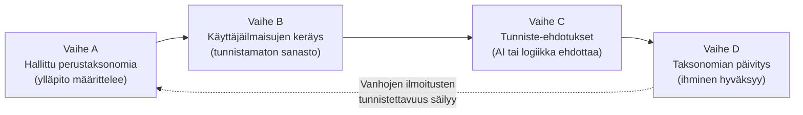
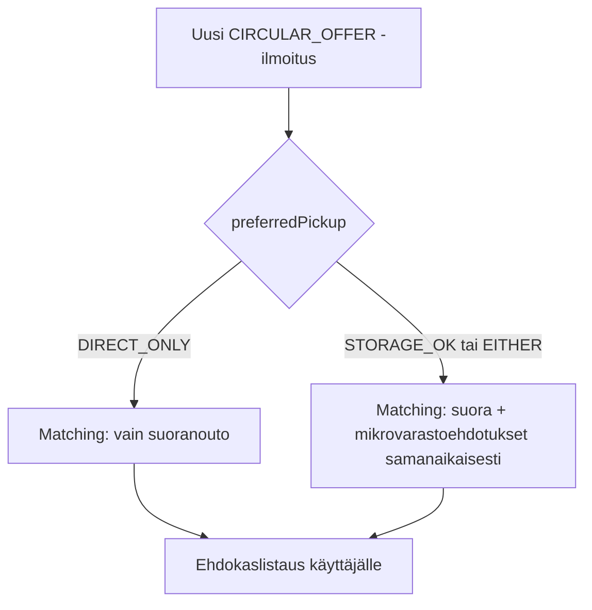
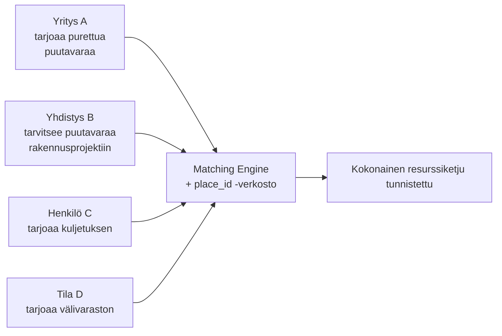
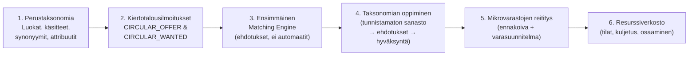

# Taksonomia ja Matching Engine -arkkitehtuuri: LostReFound
*Syvennetty kehityssuunnitelma — 20.11.2026*

> Tämä dokumentti syventää aiempaa `LOSTNFOUND_KIERTOTALOUS_JA_MIKROVARASTOINTI.md` -suunnitelmaa erityisesti tunnistejärjestelmän, matchauslogiikan ja resurssiverkostoa laajentavan arkkitehtuurin osalta.

---

## Keskeinen arkkitehtuuriperiaate

Ensin **yhteinen tunnistamisen kieli**, sitten **älykäs kohtaaminen**, lopuksi **fyysinen mikrovarastoverkosto**.

Tunnisteiden pitää olla:
- **Pysyviä ja yksilöiviä** (concept_id ei muutu taksonomian kehittyessä)
- **Hierarkkisesti laajennettavia** (uusia luokkia ilman uudelleenrakentamista)
- **Synonyymeillä rikastettavia** (käyttäjä voi kirjoittaa "eurolava" tai "EUR-lava")
- **Eri resurssityyppejä tukevia** (tavarat, tilat, kuljetus, osaaminen)
- **Versioitavia** (vanhat ilmoitukset eivät rikkoudu muutosten myötä)

---

## 1. Kolmitasoinen taksonomia

Ei rakenneta heti valtavaa valmista luokitusta — se olisi kallis ylläpitää ja tekisi ilmoittamisesta liian monimutkaista. Sen sijaan kolmitasoinen rakenne, joka kasvaa käytön myötä:

### Taso 1 — Perusluokka (category)
*Mitä resurssia etsitään tai tarjotaan?*

| Luokka | Esimerkkejä |
|---|---|
| Rakennustarvikkeet | Puu, levyt, eristeet, kiinnikkeet |
| Huonekalut | Pöydät, tuolit, hyllyt, sohvat |
| Työkalut | Käsityökalut, sähkötyökalut |
| Kodintavarat | Keittiö, tekstiilit, astiat |
| Elektroniikka | Tietokoneet, puhelimet, kodinkoneet |
| Materiaalit | Metalli, muovi, lasi, tekstiili |

### Taso 2 — Tarkentava tunniste (concept)
*Minkä tyyppisestä resurssista on kyse?*

```
Rakennustarvikkeet
  ├── Puutavara
  ├── Levytuotteet
  ├── Eristeet
  ├── Kiinnikkeet
  └── Ovet ja ikkunat
```

### Taso 3 — Yksilöivät ominaisuudet (attributes)
*Mikä tekee juuri tästä tuotteesta käyttökelpoisen?*

> **Tärkeä periaate:** Mitat, kunto, määrä ja materiaali käsitellään **erillisinä attribuutteina**, ei taksonomian haaroina. Näin taksonomia ei paisu hallitsemattomasti.

```
Puutavara [concept]
  ├── attribute: dimensionMm = "48 × 98"
  ├── attribute: lengthM = 3.0
  ├── attribute: treatment = "käsittelemätön"
  ├── attribute: condition = "käytetty"
  └── attribute: quantity = 25
```

---

## 2. Neljä tunnistetyyppiä

Kaikki samankaltaiset sanat **eivät** ole synonyymejä. Esim. EUR-lava ja teholava ovat saman luokan eri tuotteet — ne löytyvät saman kategorian kautta, mutta niitä ei yhdistetä identtisiksi.

| Tunnistetyyppi | Tehtävä | Esimerkki |
|---|---|---|
| `category_id` | Taksonominen pääluokka | `rakennustarvikkeet > puutavara` |
| `concept_id` | Tarkempi tunnistettu käsite | `kuormalava`, `eur_lava`, `teholava` |
| `alias` | Käyttäjän vaihtoehtoinen nimitys | `eurolava`, `EUR-lava` → `eur_lava` |
| `attribute` | Mitta, kunto, materiaali, määrä | `dim=48×98`, `length=3.0`, `qty=25` |

### Esimerkkejä käyttäjäilmaisujen tunnistamisesta

| Käyttäjän ilmaisu | Järjestelmän tunnistus | Tyyppi |
|---|---|---|
| Kakkosnelonen | Puutavara, 48×98 mm | concept + attribute |
| EUR-lava | Kuormalava (eur-standardi) | alias → concept |
| Eurolava | Kuormalava (eur-standardi) | alias → concept |
| Teholava | Kuormalava (teholava-tyyppi) | oma concept, ei synonyymi |
| Lavakaulus | Kuormalavan lisäosa | oma concept |
| Purkulauta | Käytetty rakennuspuutavara | alias + condition=käytetty |
| Ylijäämäeriste | Eristemateriaali | alias → category |

---

## 3. Supabase-tietomalli: taksonomiarakenne

**Ei** pelkkiä `items.tags`-kentän tekstiarvoja — ne sopivat alkuvaiheen hakusanoiksi, mutta eivät pitkän aikavälin tietomalliksi.

```sql
-- Pääluokat ja hierarkia
CREATE TABLE taxonomy_categories (
    id          uuid PRIMARY KEY DEFAULT gen_random_uuid(),
    slug        text UNIQUE NOT NULL,     -- 'rakennustarvikkeet'
    label_fi    text NOT NULL,
    parent_id   uuid REFERENCES taxonomy_categories(id),
    sort_order  int DEFAULT 0,
    status      text DEFAULT 'ACTIVE'     -- ACTIVE | DEPRECATED
);

-- Varsinaiset tunnistetut käsitteet
CREATE TABLE taxonomy_concepts (
    id               uuid PRIMARY KEY DEFAULT gen_random_uuid(),
    slug             text UNIQUE NOT NULL,  -- 'eur_lava'
    label_fi         text NOT NULL,
    category_id      uuid REFERENCES taxonomy_categories(id),
    parent_concept_id uuid REFERENCES taxonomy_concepts(id),
    status           text DEFAULT 'ACTIVE', -- ACTIVE | PROPOSED | DEPRECATED
    version          int DEFAULT 1,
    valid_from       date,
    valid_until      date
);

-- Synonyymit ja vaihtoehtoiset kirjoitusasut
CREATE TABLE taxonomy_aliases (
    id          uuid PRIMARY KEY DEFAULT gen_random_uuid(),
    alias_text  text NOT NULL,          -- 'eurolava'
    concept_id  uuid REFERENCES taxonomy_concepts(id),
    source      text DEFAULT 'ADMIN'    -- ADMIN | USER_SUGGESTION | AI_PROPOSAL
);

-- Ominaisuuksien määrittely
CREATE TABLE taxonomy_attributes (
    id              uuid PRIMARY KEY DEFAULT gen_random_uuid(),
    slug            text NOT NULL,       -- 'dimension_mm', 'length_m', 'condition'
    label_fi        text NOT NULL,
    data_type       text NOT NULL,       -- TEXT | NUMBER | ENUM | RANGE
    category_id     uuid REFERENCES taxonomy_categories(id),
    allowed_values  jsonb               -- Enum-arvoille
);

-- Ilmoitusten käsitekytkennät
CREATE TABLE item_concepts (
    item_id       uuid REFERENCES items(id),
    concept_id    uuid REFERENCES taxonomy_concepts(id),
    confidence    float DEFAULT 1.0,    -- AI-tunnistuksen varmuus
    source        text DEFAULT 'USER'   -- USER | AI
);

-- Ilmoitusten ominaisuusarvot
CREATE TABLE item_attributes (
    item_id        uuid REFERENCES items(id),
    attribute_id   uuid REFERENCES taxonomy_attributes(id),
    value_text     text,
    value_number   float,
    value_min      float,               -- Haarukka-arvoille
    value_max      float
);

-- AI:n ja käyttäjien tunniste-ehdotukset (ei päädy automaattisesti taksonomiaan)
CREATE TABLE taxonomy_suggestions (
    id          uuid PRIMARY KEY DEFAULT gen_random_uuid(),
    raw_text    text NOT NULL,           -- Alkuperäinen käyttäjän ilmaisu
    suggested_as text,                  -- 'alias' | 'new_concept' | 'new_category'
    target_id   uuid,                   -- Mihin käsitteeseen liittyy
    frequency   int DEFAULT 1,          -- Kuinka monta kertaa esiintynyt
    status      text DEFAULT 'PENDING', -- PENDING | ACCEPTED | REJECTED
    created_at  timestamptz DEFAULT now()
);
```

---

## 4. Oppiva taksonomia: nelivaiheinen kehitysmalli

> **Tärkeä periaate:** AI saa ehdottaa uusia tunnisteita, mutta **ei saa itsenäisesti muuttaa** varsinaisen taksonomian rakennetta. Muuten järjestelmässä voi olla rinnakkaisia käsitteitä (`puutavara`, `puut`, `laudat`, `rakennuspuu`) ilman hallittuja suhteita.



---

## 5. Kaksisuuntainen ja yhteensopivuusperusteinen matching

Perinteinen ilmoitusjärjestelmä vertaa, ovatko tunnisteet **samoja**.  
LostReFoundissa verrataan, voiko tarjottu resurssi **täyttää hakijan tarpeen** — myös silloin kun käyttäjät eivät käytä samoja sanoja.

### Esimerkki: Puutavaran osittainen match

| | Tarjoaja | Hakija |
|---|---|---|
| **Luokka** | Puutavara | "Runkoon sopivaa puutavaraa" |
| **Mitat** | 48 × 98 mm, 3,0 m | ~50 × 100 mm, ≥2,5 m |
| **Kunto** | Käytetty | Tyydyttävä tai parempi |
| **Määrä** | 25 kpl | 20 kpl |
| **Hinta** | Ilmainen | Budjetti: 0–50 € |

**Järjestelmän arvio:** Mitat ovat toleranssin sisällä, kunto täyttää vaatimukset, määrä on riittävä → **vahva match** vaikka käyttäjät kirjoittivat eri tavoin.

### Yhteensopivuuslogiikan tarkistettavat dimensiot

1. **Tuoteluokka:** sama tai hyväksytty vaihtoehto taksonomian kautta
2. **Materiaali:** yhteensopiva
3. **Mitat:** sallituissa rajoissa (toleranssiväli per attribuutti)
4. **Määrä:** riittävä tai **osittain riittävä** (osittaiset matchit sallitaan)
5. **Kunto:** hakijan vaatimukset täyttyvät
6. **Sijainti:** sopiva
7. **Ajankohta:** sopiva

> **Osittainen match:** Jos hakija etsii 50 kpl ja tarjoajalla on 20 kpl, ilmoitus ei ole hyödytön — se on **osittainen resurssiosuma**, joka voidaan yhdistää toiseen tarjoajaan.

---

## 6. Kaksivaiheinen pisteytysalgoritmi

Yksinkertaisessa $S = w_t S_{\text{tax}} + w_g S_{\text{geo}} + w_d S_{\text{time}} + w_p S_{\text{price}}$ -mallissa on riski: huono yhteensopivuus **kriittisessä** ominaisuudessa voi peittyä muiden hyvien pisteiden alle.

> **Esimerkki:** Hakija tarvitsee 3 m puutavaraa, tarjoajalla on 1 m pätkiä. Sijainti täydellinen, tavara ilmainen → kokonaispistemäärä silti korkea, vaikka tuote ei vastaa tarvetta.

### Vaihe 1: Yhteensopivuuden tarkistus (pakollinen gate)

Tarkistetaan ehdottomat vaatimukset ennen pisteytystä:
- [ ] Oikea resurssiluokka tai hyväksyttävä vaihtoehto
- [ ] Pakolliset ominaisuudet (mitat, kunto, materiaali)
- [ ] Määrä- ja kokorajoitukset
- [ ] Ilmoituksen aktiivisuus ja saatavuus

Jos jokin ehdoton vaatimus ei täyty → **ei pisteytyksen piiriin**.

### Vaihe 2: Kohtaamisen optimointi (pisteytys)

| Osa-alue | Paino | Huomio |
|---|---|---|
| Sijainti + kulkureitti | 35 % | Etäisyys, saavutettavuus, mikrovaraston sijoittuminen arjen reitille |
| Noutojärjestely | 20 % | Suoranouto vs. mikrovarasto, kuljetusmahdollisuus |
| Aika + jousto | 20 % | Noutoikkuna, deadline, varastoaika |
| Kunnon sopivuus | 15 % | Hakijan toleranssi suhteessa tarjottuun kuntoon |
| Hinta + vaihto | 10 % | Hintahaarukka, pantti, vaihto |

### Kaksi erillistä tulossuuretta

```
match_confidence   = Kuinka hyvin resurssit vastaavat toisiaan (tuoteosuma)
fulfillment_score  = Kuinka helposti resurssi saadaan tosiasiallisesti siirrettyä
```

> Hyvä `match_confidence` ei takaa onnistumista. Mutta mikrovarasto, kuljetus tai joustava noutoaika voi muuttaa muuten mahdottoman kohtaamisen toteuttamiskelpoiseksi — **fulfillment_score** mittaa juuri tätä.

---

## 7. Matches-taulu: erillinen analyysirakenne

Yhdellä ilmoituksella voi olla **monta ehdokasta** — `matchedItemId` yhdessä ilmoituksessa ei riitä.

```sql
CREATE TABLE matches (
    id                uuid PRIMARY KEY DEFAULT gen_random_uuid(),
    offer_item_id     uuid REFERENCES items(id),
    wanted_item_id    uuid REFERENCES items(id),

    -- Pisteytys
    taxonomy_score    float,
    geo_score         float,
    time_score        float,
    price_score       float,
    match_confidence  float,       -- Resurssien vastaavuus yhteensä
    fulfillment_score float,       -- Toimitettavuus (mikrovarasto, kuljetus jne.)

    -- Tila
    match_status         text,     -- PROPOSED | ACCEPTED | REJECTED | EXPIRED | FULFILLED
    storage_location_id  uuid REFERENCES storage_locations(id),

    -- Hallinta
    created_at    timestamptz DEFAULT now(),
    accepted_at   timestamptz,
    fulfilled_at  timestamptz
);
```

---

## 8. Mikrovarastointi: ennakoiva, ei vain varasuunnitelma

Tarjoaja voi jo ilmoitusta tehdessään valita mikrovarastoinnin. Silloin järjestelmä etsii hakijaa ja sopivaa varastopaikkaa **samanaikaisesti** — ei vasta epäonnistuneen suoran matchin jälkeen.



---

## 9. Resurssityyppien laajentaminen

Kun taksonomia rakennetaan oikein, **samaa tunnistusjärjestelmää voidaan laajentaa muihinkin resursseihin** myöhemmin ilman tietomallin uudelleenrakentamista.

| Resurssityyppi | Esimerkkejä | Erityisattribuutit |
|---|---|---|
| **Tavarat** | Huonekalut, työkalut, kodinkoneet | Mitat, kunto, materiaali |
| **Materiaalit** | Puu, metalli, muovi, rakennusmateriaalit | Paino, m², m³, kpl |
| **Tilat** | Varastot, säilytystilat, noutopisteet | m², käyttöaika, rajoitukset |
| **Kuljetus** | Peräkärry, pakettiauto, kuljetuskapasiteetti | Kantavuus, tilavuus, ajankohta |
| **Osaaminen** | Korjaus, kunnostus, purkaminen | Erikoisala, kokemus |
| **Työpanos** | Talkootyö, noutoapu, lajittelu | Tuntimäärä, ajankohta |

### Resurssiketjun tunnistaminen



> **Yhteys LaukaaInfoon:** `place_id`-malli voi toimia resurssien alueellisena viitekehyksenä ilman, että LostReFoundin tarvitsee rakentaa omaa rinnakkaista paikkahierarkiaansa.

---

## 10. Korjaukset alkuperäiseen tietomalliin

| Alkuperäinen | Suositus | Perustelu |
|---|---|---|
| `matchedItemId` yhdessä ilmoituksessa | Erillinen `matches`-taulu | Yhdellä ilmoituksella voi olla useita ehdokkaita |
| `tags: List<String>` | Pysyvät `concept_id`:t + `item_attributes` | Yhteensopivuus säilyy taksonomian kehittyessä |
| Kiinteä 70 % raja | Eri match-tyypeille omat kynnysarvot | Puutavaran kriittiset mitat ≠ kirjan kunto |
| PIN-koodi ilmoituksessa | Erillinen noutovarmennus, hashattuna | Tietoturva |
| Yksi varastopaikan tila | Varastopaikka + yksittäiset säilytyspaikat erikseen | Usean esineen samanaikainen varastointi |
| Pelkkä etäisyys | Etäisyys + kulkureitti + varaston saavutettavuus | Merkittävä vaikutus fulfillment_score:een |

---

## 11. Vaiheistettu kehityspolku (päivitetty)



---

*Päivitetty kehityssuunnitelma — 20.11.2026*  
*Pohjautuu kehityskeskusteluun alkuperäisen `LOSTNFOUND_KIERTOTALOUS_JA_MIKROVARASTOINTI.md` -dokumentin laajentamiseksi.*

