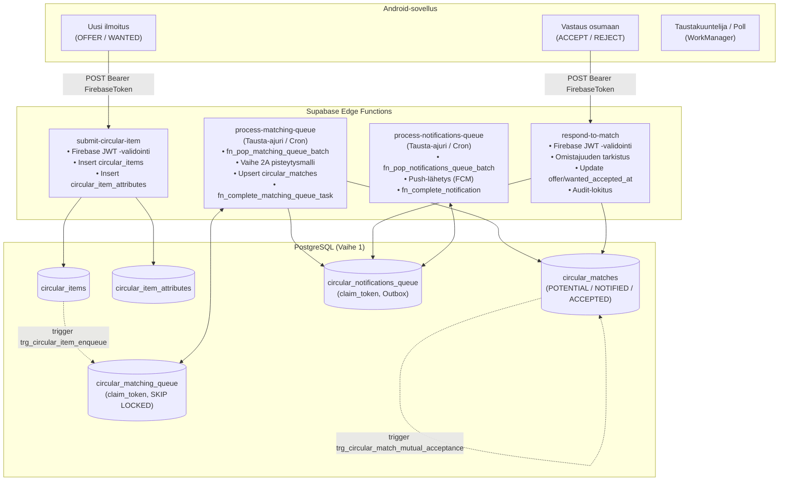

# Vaihe 2B: Supabase Edge Functions ja Gateway-arkkitehtuuri
*LostReFound — Kiertotalouden palvelinrajapinnat ja jononpurkajat — 20.11.2026*

---

## 1. Yleiskatsaus ja Gateway-malli

Kiertotalousmoduuli noudattaa **Gateway-arkkitehtuuria**, jossa mobiilisovelluksella tai `anon`-roolilla ei ole suoria kirjoitusoikeuksia tietokantatauluihin. Kaikki kirjoitusoperaatiot ja jononkäsittelyt hoidetaan **Supabase Edge Function** -funktioiden kautta käyttäen `service_role`-avainta.

Käyttäjän todennus perustuu **Firebase ID Tokeniin** (`Bearer <token>`), joka varmennetaan suoraan Googlen virallisesta JWK-osoitteesta (`jose`-kirjasto).



---

## 2. Toteutetut Edge Functionit

| Funktio | Tyyppi | Tarkoitus | Pääsynhallinta |
|---|---|---|---|
| `process-matching-queue` | Worker / Cron | Poimii tehtävät jonosta fencing tokenilla, ajaa Vaihe 2A:n pisteytyksen ja luo osumat sekä ilmoitukset. | Palvelinkutsu / Cron |
| `submit-circular-item` | Asiakasrajapinta | Vastaanottaa ja tallentaa uuden kiertotalousilmoituksen ja sen attribuutit. | Bearer Firebase ID Token |
| `respond-to-match` | Asiakasrajapinta | Käsittelee osuman hyväksymisen (ACCEPT) tai hylkäämisen (REJECT). | Bearer Firebase ID Token |
| `process-notifications-queue` | Worker / Cron | Purkaa outbox-notifikaatiojonon fencing tokenilla ja lähettää viestit. | Palvelinkutsu / Cron |

---

## 3. Funktiokohtaiset kuvaukset ja rajapintasopimukset

### 3.1. `process-matching-queue` (Kiertotalouden matchausmoottori)
- **Polku:** `supabase/functions/process-matching-queue/index.ts`
- **Pisteytyslogiikka:** `scoring.ts` (Vaihe 2A)
- **Toiminta:**
  1. Kutsuu `fn_pop_matching_queue_batch(p_batch_size)` $\rightarrow$ saa erän tehtäviä ja `claim_token`-lukituksen.
  2. Hakee ilmoituksen tiedot ja attribuutit.
  3. Hakee vastakkaisen tyypin aktiiviset kandidaatit (`OFFER` $\leftrightarrow$ `WANTED`).
  4. Suorittaa pisteytyksen:
     - **Hard Gating:** eri `firebase_uid`, vastakkainen tyyppi, molemmat `ACTIVE`, alustava etäisyyskarsinta.
     - **Match Confidence ($S_{\text{conf}}$):** Teksti ($0.35$), mitat/toleranssi ($0.30$), määrä ($0.20$), kunto ($0.15$).
     - **Fulfillment Score ($S_{\text{fulf}}$):** PostGIS-etäisyys clamped ($0.45$), aikaikkunan interpolaatio ($0.35$), noutotapa ($0.20$).
     - **Kokonaispiste:** $S_{\text{total}} = 0.60 S_{\text{conf}} + 0.40 S_{\text{fulf}}$.
  5. Kirjaa tuloksen `circular_matches`-tauluun:
     - $S_{\text{total}} \ge 0.75 \implies \text{'NOTIFIED'}$
     - $0.50 \le S_{\text{total}} < 0.75 \implies \text{'POTENTIAL'}$
  6. Jos $S_{\text{total}} \ge 0.75$, luo välittömät herätteet `circular_notifications_queue`-tauluun molemmille osapuolille.
  7. Kuittaa tehtävän valmiiksi atomisesti: `fn_complete_matching_queue_task(queue_id, claim_token)`.

---

### 3.2. `submit-circular-item` (Ilmoituksen jättö)
- **Polku:** `supabase/functions/submit-circular-item/index.ts`
- **Metodi:** `POST`
- **Otsakkeet:** `Authorization: Bearer <firebase_id_token>`, `Content-Type: application/json`
- **Pyyntörunko (Body):**
```json
{
  "item_type": "OFFER",
  "title": "Kakkosnelosta 48x98 kuivaa runkopuuta",
  "description": "Yli jäänyttä puhdasta puutavaraa",
  "place_id": "lievestuore-hub",
  "place_name_snapshot": "Lievestuoreen noutopiste",
  "latitude": 62.2612,
  "longitude": 26.2023,
  "radius_meters": 25000,
  "deadline_at": "2026-12-01T12:00:00Z",
  "price_eur": 0.00,
  "condition": "GOOD",
  "preferred_pickup": "EITHER",
  "contact_info": "Puhelin: 0401234567",
  "attributes": {
    "category_code": "wood_timber",
    "material": "puu",
    "quantity": 200,
    "unit": "m",
    "dimension_width_mm": 48,
    "dimension_height_mm": 98,
    "dimension_length_mm": 3000
  }
}
```
- **Vastaus (201 Created):**
```json
{
  "success": true,
  "item": {
    "id": "550e8400-e29b-41d4-a716-446655440000",
    "item_type": "OFFER",
    "title": "Kakkosnelosta 48x98 kuivaa runkopuuta",
    "status": "ACTIVE",
    "firebase_uid": "user-offer-123",
    "created_at": "2026-11-20T13:40:00.000Z",
    "attributes": { ... }
  }
}
```

---

### 3.3. `respond-to-match` (Kohtaamisen kuittaus)
- **Polku:** `supabase/functions/respond-to-match/index.ts`
- **Metodi:** `POST`
- **Otsakkeet:** `Authorization: Bearer <firebase_id_token>`, `Content-Type: application/json`
- **Pyyntörunko:**
```json
{
  "match_id": "8fa32009-bf25-4c07-96a8-a472c3d5e219",
  "action": "ACCEPT"
}
```
*tai hylkäystapauksessa:*
```json
{
  "match_id": "8fa32009-bf25-4c07-96a8-a472c3d5e219",
  "action": "REJECT",
  "reason": "Ei mahdu autoon noudettaessa"
}
```
- **Toiminta:**
  - Varmistaa, että kutsuja on joko tarjouksen tai pyynnön tekijä.
  - Päivittää `offer_accepted_at` tai `wanted_accepted_at`.
  - Tietokannan triggeri `trg_fn_check_mutual_acceptance` muuttaa statuksen tilaan `ACCEPTED`, kun molemmat ovat hyväksyneet.
  - Kirjaa audit-tapahtuman `circular_match_events`-tauluun todennetulla käyttäjätunnisteella.
  - Generoi tilanteen mukaiset outbox-viestit `circular_notifications_queue`-tauluun.

---

### 3.4. `process-notifications-queue` (Push-lähettäjä)
- **Polku:** `supabase/functions/process-notifications-queue/index.ts`
- **Toiminta:**
  1. Kutsuu `fn_pop_notifications_queue_batch(batch_size)` $\rightarrow$ saa erän tehtäviä lukittuna `claim_token`-fencing-tokenilla.
  2. Suorittaa lähetyksen.
  3. Kuittaa onnistumisen: `fn_complete_notification(id, claim_token)`.
  4. Kuittaa virhetilanteen: `fn_fail_notification(id, claim_token, err)`.

---

## 4. Ympäristömuuttujat (Supabase Secrets)

Jokaiselle Edge Functionille määritetään seuraavat asetukset (Supabase Dashboard $\rightarrow$ Project Settings $\rightarrow$ Edge Functions $\rightarrow$ Secrets):

| Muuttuja | Kuvaus | Esimerkki |
|---|---|---|
| `SUPABASE_URL` | Projektin Supabase API URL (automaattinen) | `https://xyz.supabase.co` |
| `SUPABASE_SERVICE_ROLE_KEY` | Supabase Service Role -avain (automaattinen) | `eyJh...` |
| `FIREBASE_PROJECT_ID` | Firebase-projektin ID JWT-varmennukseen | `lostrefound-prod` |
| `FIREBASE_SERVICE_ACCOUNT_KEY` | Valinnainen: Service account JSON FCM-lähetykseen | `{"type": "service_account"...}` |

---

## 5. Käyttöönotto (Deployment)

Funktiot otetaan käyttöön Supabase CLI:llä ilman Supabasen sisäistä JWT-pakotusta (`--no-verify-jwt`), koska todennus hoidetaan suoraan funktioissa Firebase ID Tokenilla:

```bash
supabase functions deploy process-matching-queue --no-verify-jwt
supabase functions deploy submit-circular-item --no-verify-jwt
supabase functions deploy respond-to-match --no-verify-jwt
supabase functions deploy process-notifications-queue --no-verify-jwt
```

